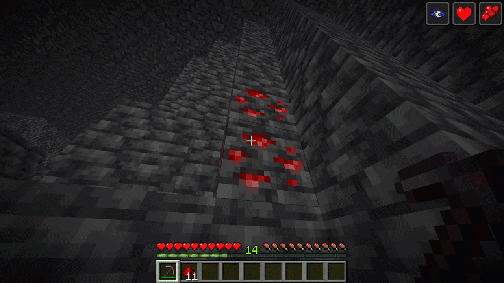

<p align="center">
  
</p>

<h1 align="center">⛏️ PVeinMiner</h1>

Mine the whole vein on mining a single ore/block. Make the tedious mining experience to something satisfying and fun!

A Veinminer addon inspired by [Miraculixx's Veinminer](https://modrinth.com/datapack/veinminer) for PumpkinMC servers.



[!WARNING] This plugin is still in early development; expect bugs!

## Configuration

```yaml
# Set enabled to false to disable vein mining.
enabled: true
debug: false
max_vein_blocks: 128

blocks:
  "minecraft:ancient_debris":
    min: 0
    max: 0
  "minecraft:diamond_ore":
    min: 3
    max: 7
  "minecraft:deepslate_diamond_ore":
    min: 3
    max: 7
# ...
```
### Adding custom blocks

Let's add spruce logs as an example!

Append to the end of the file:

```yaml
"minecraft:spruce_log": # block id
    min: 0 # Minimum xp to drop
    max: 0 # Maximum xp to drop
```

## Contributing

Contributions are welcome! Feel free to submit pull requests or open issues to report bugs, suggest features, or share ideas.

## Technical details

If you're intrested in the technical details of this mod, Check out [Technical_details.md](./Technical_details.md)

---------

Made with ❤️ by yousif51811 (Zerorifter)